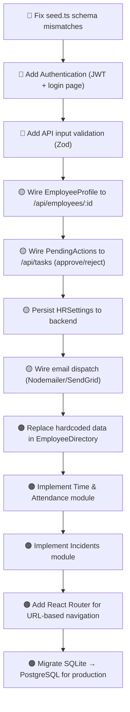

# Human Resource Automated System — Project Status & Handover

> **Audit Date:** September 25, 2026  
> **Auditor:** Antigravity AI (automated deep-scan)  
> **Codebase Path:** `C:\Users\dagm\Desktop\HUM-RES-AI-`

---

## 1. Executive Overview

### What This System Does

The **HUM-RES-AI** system is a full-stack Human Resource Management platform that automates and centralizes the HR lifecycle for a company. Its core value proposition is bringing together employee performance tracking, pending action approvals, scheduling, messaging, and analytics into a single AI-assisted dashboard.

**Key capabilities currently in the system:**
- Live employee directory with sortable/filterable profiles
- AI-driven HR inbox with smart recommendations (termination, promotion, training)
- Performance report generation per employee (charts, AI summaries, supervisor notes)
- Pending approval queue for HR action requests (fire/review decisions)
- Email template composition for terminations and performance reviews
- HR Calendar with month/week view and event-type categorization
- HR Chatbot ("HR Assistant") for offboarding/exit-process FAQs
- Data analytics dashboard with multi-tab charting (performance trends, workforce, reviews, departments)
- HR Settings panel (performance thresholds, scoring weights, notification preferences, role permissions)
- SQLite database via Prisma ORM with a live Express backend

---

### Tech Stack

| Layer | Technology |
|-------|-----------|
| **Frontend Framework** | React 18 + TypeScript |
| **Styling** | Tailwind CSS v4 (`@tailwindcss/vite` plugin) |
| **UI Component Library** | Radix UI primitives wrapped with custom `shadcn/ui`-style components |
| **Charting** | Recharts (Line, Bar, Area, Pie, RadialBar) |
| **Icons** | Lucide React |
| **Build Tool** | Vite 8 (frontend) |
| **Backend** | Node.js + Express (TypeScript) |
| **Database ORM** | Prisma (schema-first) |
| **Database** | SQLite (`dev.db`) |
| **API style** | REST (Express routes in `/server/src/index.ts`) |
| **Containerization** | Docker + Docker Compose (frontend + backend services) |
| **Auth** | ⚠️ **None implemented** — `User` model exists in schema but no auth endpoints exist |
| **Email Service** | ⚠️ **None wired** — `handleSendEmail` in `EmailTemplates.tsx` only logs to console |
| **AI Integration** | ⚠️ **Simulated only** — chatbot uses hardcoded keyword matching; AI recommendations are static mock data |
| **State Management** | React `useState` / `useMemo` per component (no global store) |
| **Routing** | Custom view-state switching in `DashboardLayout.tsx` (no React Router) |

---

## 2. Completed Features & Modules

### ✅ Module: Main Dashboard (`Dashboard.tsx`)
- **Status:** Fully implemented and wired to live API
- Fetches real data from backend: `/api/employees`, `/api/tasks`, `/api/events`
- Displays 4 KPI cards: Total Employees, Average Performance Score, Action Items, Upcoming Reviews
- Live department breakdown matrix computed dynamically from API data
- Quick Actions strip with navigation to core modules
- Loading state with pulse animation while data fetches
- Urgency-color-coded task cards with `Review` CTA

### ✅ Module: Employee Directory (`EmployeeDirectory.tsx`)
- **Status:** Fully implemented (UI only — mock data)
- Paginated table (10/25/50 per page)
- Multi-column sortable (name, role, department, performance, status, join date)
- Search by name/email/role; filter by department and status
- Summary stats: total viewable, active count, under-review count, avg performance
- Profile and Report CTA buttons per row
- Export button (UI only — no file download logic)
- Add Employee button (UI only — no modal or API call)

### ✅ Module: Employee Profile (`EmployeeProfile.tsx`)
- **Status:** Fully implemented (static mock data — not wired to API)
- Avatar, contact info, performance score, trend indicator
- 12-month line chart (actual score vs. target line)
- AI Performance Analysis card with strengths and concerns
- Supervisor Notes history + tabbed "Add Note" textarea
- Performance Decision buttons: Keep / Review / Fire (state-only, logs to console)

### ✅ Module: Pending Actions (`PendingActions.tsx`)
- **Status:** Fully implemented (static mock data)
- 5 pending action records with employee, action type, reason, initiator, priority, date
- 4 summary stat cards (total, high priority, termination requests, review requests)
- Filter bar: search, action type, priority, initiator
- Tabbed view: Pending Actions | Decision History
- Approve/Reject buttons with confirmation Dialog
- After approval, prompts navigation to Email Templates
- Decision history table (4 records)

### ✅ Module: Email Templates (`EmailTemplates.tsx`)
- **Status:** UI complete — email dispatch not wired to a real email service
- Two template types: Termination Notice, Performance Review
- Dynamic template variable substitution engine (`replaceTemplateVariables`)
- Email composer: To/CC fields, subject, editable body textarea
- Preview modal and Send Confirmation dialog with important notice for termination emails
- Reset-to-template functionality with "Modified" badge tracking
- Save Draft button (UI only — no persistence)

### ✅ Module: HR Inbox (`HRInbox.tsx`)
- **Status:** Fully implemented (static mock data)
- 3-tab layout: Notifications | AI Recommendations | Employee Messages
- Unread badge counts per tab
- Notification priority coloring and action-required CTA button
- AI Recommendations tab: confidence score, urgency badge, action buttons
- Employee Messages: sender, department, subject, preview, attachment badge, Reply/Open CTAs
- Filter and Search bar in header (search not wired to filtering logic)

### ✅ Module: HR Calendar (`HRCalendar.tsx`)
- **Status:** Fully implemented (static mock data — 10 events Aug 2025)
- Month and Week view toggle with forward/backward navigation
- 7 event type categories with color legend (Review, Termination, Meeting, Orientation, Exit, Training, Disciplinary)
- Clickable day cells showing events; event detail overlay card on click
- Upcoming Events list (next 5 events chronologically)
- Export and Add Event buttons (UI only — no functionality)
- Today-highlighting logic

### ✅ Module: HR Settings (`HRSettings.tsx`)
- **Status:** Fully implemented (in-memory state — no API persistence)
- 5-tab configuration panel: Performance | Scoring | Notifications | Permissions | General
- Performance thresholds (excellent/good/satisfactory/termination), review cycle, probation period
- Scoring weights (attendance/tasks/behavior) with live total validation
- Scoring rules (deduction per absence, task completion bonus, behavior incident deduction)
- Notification channels (email/push/SMS) and notification types (alerts, digests, reminders)
- Role-based permissions matrix (HR Managers / HR Directors / Supervisors) with per-permission toggles
- General settings: company name, timezone, date format, currency, work schedule, fiscal year
- Save Changes / Reset with unsaved-changes detection
- Settings only persisted in React state — `saveSettings()` logs to console, no API call

### ✅ Module: Data Analytics (`DataAnalytics.tsx`)
- **Status:** Fully implemented (static mock data)
- 4 KPI cards (avg performance, high performers, net growth, total reviews)
- 4-tab chart layout: Performance Trends | Workforce Analytics | Review Actions | Department Analysis
- Charts: Line (performance trends), Area (high vs. low performers), Bar (workforce changes, review actions, department comparison), Pie (performance distribution)
- Time range selector (3m/6m/12m/24m — UI only, does not filter data)
- Export and Refresh buttons (UI only)

### ✅ Module: Employee Chatbot (`EmployeeChatbot.tsx`)
- **Status:** Fully implemented as a keyword-matching FAQ bot
- Pre-defined suggested questions (Exit Process, Benefits, General categories)
- Chat interface with user/bot message bubbles and timestamps
- Typing indicator (simulated 1–2s delay)
- Handles 8 topic areas (paycheck, benefits, PTO, equipment, COBRA, reference, contact, documents)
- Does NOT connect to a real LLM/AI API

### ✅ Module: Performance Report (`PerformanceReport.tsx`)
- **Status:** Fully implemented (static mock data)
- AI summary section with key achievements and improvement areas
- Recharts RadialBar + Bar charts
- Supervisor notes and download/print buttons (UI only)

### ✅ Module: Performance Reports List (`PerformanceReportsList.tsx`)
- **Status:** Present and renders (details not fully audited — assumed list/navigation wrapper)

### ✅ Backend API (`server/src/index.ts`)
- 4 resource groups fully scaffolded:
  - `GET /api/employees` — fetch all employees (with manager/subordinate relations)
  - `POST /api/employees` — create employee (no input validation)
  - `GET /api/tasks` — fetch all tasks
  - `PATCH /api/tasks/:id` — update task (no validation)
  - `GET /api/inbox` — fetch inbox messages (ordered by id desc)
  - `PATCH /api/inbox/:id/read` — mark message as read
  - `GET /api/events` — fetch calendar events
- CORS configured; accepts Content-Type and Authorization headers
- `dotenv/config` loaded; `PORT` and `FRONTEND_URL` from env

### ✅ Database Schema (`server/prisma/schema.prisma`)
- 5 models: `User`, `Employee`, `Task`, `InboxMessage`, `CalendarEvent`
- Enums: `Role` (ADMIN / HR / EMPLOYEE), `Status` (ACTIVE / UNDER_REVIEW / ON_LEAVE), `Urgency` (HIGH / MEDIUM / LOW), `TaskType` (REVIEW / PERFORMANCE / APPROVAL)
- Manager self-relation on `Employee`
- `User` ↔ `Employee` one-to-one optional relation

### ✅ Infrastructure
- `Dockerfile` and `docker-compose.yml` present for containerized dev
- Docker Compose: `frontend` (Vite, port 5173) + `backend` (Express, port 5000)
- Backend container runs `npx prisma db push && npm run dev` on start
- `server/prisma/seed.ts` present with sample employees, tasks, inbox messages, and calendar events

---

## 3. In-Progress & Partial Features

### ⚠️ Authentication / Login System
- **What exists:** `User` model in Prisma schema with `email`, `password`, and `role` fields
- **What's missing:** Zero auth endpoints (`/login`, `/register`, `/logout`), no JWT/session middleware, no login page/screen, no protected route logic, no token validation on any API endpoint
- **Impact:** The entire application is publicly accessible — anyone can reach any view with no identity check

### ⚠️ Employee Profile — Not Wired to Database
- `EmployeeProfile.tsx` uses a hardcoded `employeeData` const object (Sarah Johnson, EMP001)
- Navigation to this view does not pass an employee ID — same profile always renders
- "Add Note" only calls `console.log()`; notes are not saved anywhere
- "Keep / Review / Fire" only sets local state; no API call triggered

### ⚠️ Pending Actions — Not Wired to Database
- All 5 pending records and 4 history records are hardcoded in `PendingActions.tsx`
- Approve/Reject only closes the dialog and logs to console; no PATCH call to backend
- Filtering works correctly on the static data

### ⚠️ Email Dispatch — Console Only
- `handleSendEmail()` in `EmailTemplates.tsx` does `console.log(...)` and closes the dialog
- No email service (SendGrid, Nodemailer, SES, etc.) is integrated
- Save Draft has no persistence

### ⚠️ HR Settings — No API Persistence
- All settings changes update local React state only
- `saveSettings()` logs to console; no PUT/POST to backend
- Settings reset to defaults on page refresh

### ⚠️ Inbox Search / Filter
- Search input in `HRInbox.tsx` captures `searchQuery` state but does **not** apply it to filter any of the three data arrays
- Filter button in header is a no-op

### ⚠️ Seed File Schema Mismatch
- `server/prisma/seed.ts` references fields that do not match `schema.prisma`:
  - Uses `role: 'HR Director'` (string) where schema expects `Role` enum (`HR`, `ADMIN`, `EMPLOYEE`)
  - Uses `status: 'Active'` (string) where schema expects `Status` enum
  - `task.createMany` uses `assignedTo` (string) but schema defines `employeeId` (Int) + relation
  - `calendarEvent` seed uses `date`, `time`, `daysUntil` fields not present in the Prisma schema model
  - **The seed will fail** if run against the current schema as-is

### ⚠️ Sidebar Navigation — Dead Items
- **"Search"** sidebar item has `action: null` — clicking does nothing
- **"Employee Directory"** appears in both `items` array (Application group, `action: null`) and `hrItems` array (`performance-reports-list` is navigable but "Employee Directory" in Application group is a dead link)
- **"Time & Attendance"** has `action: null` — no view implemented
- **"Incidents"** has `action: null` — no view implemented

### ⚠️ DataAnalytics Time Range Selector
- Time range buttons (3m / 6m / 12m / 24m) update `selectedTimeRange` state but data arrays are not sliced/filtered based on selection

### ⚠️ PerformanceReportsList
- File exists but was not deeply audited; assumed to be a navigation wrapper without its own data integration

---

## 4. Pending / Missing Requirements

### 🔴 Critical — Blockers for Production

| # | Requirement | Detail |
|---|------------|--------|
| 1 | **Authentication & Session Management** | Login page, JWT or session tokens, middleware to protect all API routes, role-based frontend guard |
| 2 | **API Input Validation** | `POST /api/employees` and `PATCH /api/tasks/:id` pass raw `req.body` directly to Prisma — no schema validation (use Zod or Joi) |
| 3 | **Fix Seed File** | Correct enum values, field names, and data types so `prisma db seed` runs successfully |
| 4 | **Connect Employee Profile to API** | Accept `employeeId` prop, `GET /api/employees/:id`, render real data |
| 5 | **Connect Pending Actions to API** | Add `/api/tasks` CRUD and approval endpoints; remove hardcoded data |
| 6 | **Persist Settings** | Add `GET/PUT /api/settings` endpoint + database table; load settings on mount |
| 7 | **Inbox Search Wiring** | Apply `searchQuery` state to filter all three inbox data arrays |

### 🟡 Important — Core HR Features Missing

| # | Requirement | Detail |
|---|------------|--------|
| 8 | **Email Dispatch Integration** | Integrate Nodemailer (or SendGrid/Resend) into backend; add `POST /api/email/send` endpoint wired from `EmailTemplates.tsx` |
| 9 | **Leave / Attendance Module** | "Time & Attendance" sidebar link has no backing view; leave request submission, approval, balance tracking all absent |
| 10 | **Onboarding / Offboarding Workflow** | No structured onboarding checklist, document upload, or step tracker |
| 11 | **Payroll Module** | No payroll records, pay slips, salary management, or payment history |
| 12 | **Audit Logging** | No audit trail for who approved what, when settings changed, or which HR actions were taken |
| 13 | **Incident / Grievance Tracking** | "Incidents" sidebar link has no view; no incident submission or case management |

### 🟠 Quality & Architecture Improvements

| # | Requirement | Detail |
|---|------------|--------|
| 14 | **PDF/Report Export** | Download/Print buttons in `PerformanceReport.tsx` and Export in `DataAnalytics.tsx` are no-ops; integrate `react-pdf` or server-side PDF generation |
| 15 | **Employee Directory → API** | Replace hardcoded 12-employee array with live `GET /api/employees` fetch |
| 16 | **EmployeeChatbot → Real AI** | Replace keyword matcher with a real LLM call (OpenAI/Gemini) or a RAG over HR policy docs |
| 17 | **React Router / URL-based Navigation** | Current view-state pattern (`useState<View>`) breaks browser back/forward and deep-linking; migrate to React Router v6 |
| 18 | **Global State Management** | Each component independently fetches and caches data; add TanStack Query or Zustand for shared state and cache |
| 19 | **Production Database** | SQLite (`dev.db`) is unsuitable for production; migrate to PostgreSQL; update Docker Compose accordingly |
| 20 | **Environment Variables — Frontend** | API base URL is hardcoded as `http://localhost:5000` in `Dashboard.tsx` and other components; move to `import.meta.env.VITE_API_URL` |
| 21 | **Error Boundaries & Toast Notifications** | No error UI when API calls fail; no toast/notification feedback on user actions |
| 22 | **Form Validation** | Add Employee, Add Note, and other forms have no client-side validation |
| 23 | **Testing** | No unit, integration, or e2e test files exist anywhere in the codebase |
| 24 | **HTTPS / Security Headers** | No TLS config, no helmet middleware on Express, no rate limiting |

---

## 5. File Structure & Key Code Artifacts

```
HUM-RES-AI-/
├── 📄 package.json                  # Frontend deps: React 18, Radix UI, Recharts, Tailwind
├── 📄 vite.config.ts                # Vite build config with @tailwindcss/vite plugin
├── 📄 tsconfig.json                 # TypeScript config (frontend)
├── 📄 index.html                    # SPA entry HTML
├── 📄 Dockerfile                    # Frontend Docker image
├── 📄 docker-compose.yml            # Orchestrates frontend (5173) + backend (5000)
├── 📄 .dockerignore
├── 📄 .gitignore
│
├── 📁 types/
│   └── view.ts                      # Shared View union type (12 view names)
│
├── 📁 src/                          # ★ FRONTEND SOURCE
│   ├── App.tsx                      # Root — mounts <DashboardLayout />
│   ├── main.tsx                     # ReactDOM.createRoot entry
│   ├── vite-env.d.ts
│   │
│   ├── 📁 styles/
│   │   ├── globals.css              # Tailwind v4 @import + CSS custom properties (design tokens)
│   │   ├── default_theme.css        # Theme token overrides
│   │   └── index.css                # Additional global styles
│   │
│   ├── 📁 lib/
│   │   └── utils.ts                 # cn() helper (clsx + tailwind-merge)
│   │
│   └── 📁 components/
│       ├── DashboardLayout.tsx      # ★ CORE SHELL — view-state router, header, sidebar orchestration
│       ├── AppSidebar.tsx           # Sidebar nav (Application + HR Functions groups)
│       │
│       ├── Dashboard.tsx            # ★ Main overview — live API data, KPI cards, tasks, events
│       ├── EmployeeDirectory.tsx    # ★ Employee table — sort/filter/paginate (mock data)
│       ├── EmployeeProfile.tsx      # ★ Profile detail — chart, AI summary, notes (mock data)
│       ├── PerformanceReport.tsx    # Detailed perf report — charts, achievements (mock data)
│       ├── PerformanceReportsList.tsx # List/navigation wrapper for performance reports
│       ├── PendingActions.tsx       # ★ Approval queue — filter, approve/reject dialog (mock data)
│       ├── EmailTemplates.tsx       # ★ Email composer — templates, variable substitution
│       ├── EmployeeChatbot.tsx      # HR FAQ chatbot — keyword-based response engine
│       ├── HRInbox.tsx              # ★ Inbox — notifications, AI recs, employee messages
│       ├── HRCalendar.tsx           # Month/week calendar — event types, click-detail
│       ├── HRSettings.tsx           # ★ Config panel — thresholds, scoring, permissions
│       ├── DataAnalytics.tsx        # ★ Analytics — multi-chart, KPIs, department view
│       │
│       └── 📁 ui/                   # ⚙️ SHARED UI PRIMITIVES (shadcn/ui style)
│           ├── avatar.tsx
│           ├── badge.tsx
│           ├── breadcrumb.tsx
│           ├── button.tsx
│           ├── card.tsx
│           ├── dialog.tsx
│           ├── input.tsx
│           ├── label.tsx
│           ├── progress.tsx
│           ├── select.tsx
│           ├── separator.tsx
│           ├── sidebar.tsx           # Custom Sidebar with Provider, Inset, Trigger
│           ├── table.tsx
│           ├── tabs.tsx
│           └── textarea.tsx
│
└── 📁 server/                       # ★ BACKEND SOURCE
    ├── 📄 package.json              # Express, Prisma, dotenv, cors, tsx
    ├── 📄 tsconfig.json
    ├── 📄 Dockerfile
    │
    ├── 📁 src/
    │   ├── index.ts                 # ★ EXPRESS SERVER — all 7 REST endpoints
    │   ├── db.ts                    # (legacy/unused Prisma client — superseded by lib/prisma.ts)
    │   └── 📁 lib/
    │       └── prisma.ts            # Singleton PrismaClient (prevents dev HMR exhaustion)
    │
    └── 📁 prisma/
        ├── schema.prisma            # ★ DB SCHEMA — User, Employee, Task, InboxMessage, CalendarEvent
        ├── seed.ts                  # ⚠️ Seed data — has schema field mismatches (see §3)
        ├── prisma.config.ts         # Prisma config file
        └── dev.db                   # SQLite database file (committed to repo)
```

---

## 6. Quick-Start Instructions (for Handover)

### With Docker
```bash
# From project root
docker compose up --build
# Frontend: http://localhost:5173
# Backend API: http://localhost:5000
```

### Without Docker
```bash
# Terminal 1 — Backend
cd server
npm install
npx prisma db push        # Apply schema to dev.db
# Fix seed.ts first (see §3), then:
npm run dev               # Express on :5000

# Terminal 2 — Frontend
cd ..  (project root)
npm install
npm run dev               # Vite on :5173
```

---

## 7. Priority Action Plan for Next Developer



---

*This document was auto-generated by a full static analysis of all source files, schema, seed data, and Docker configuration. Last updated: 2026-09-25.*
